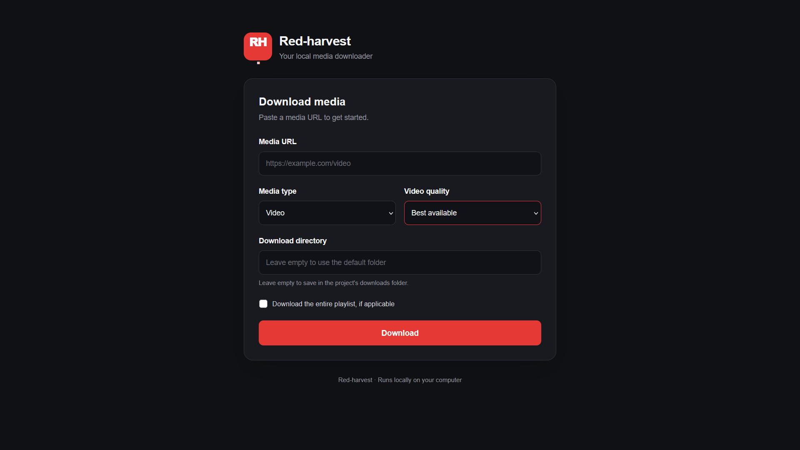
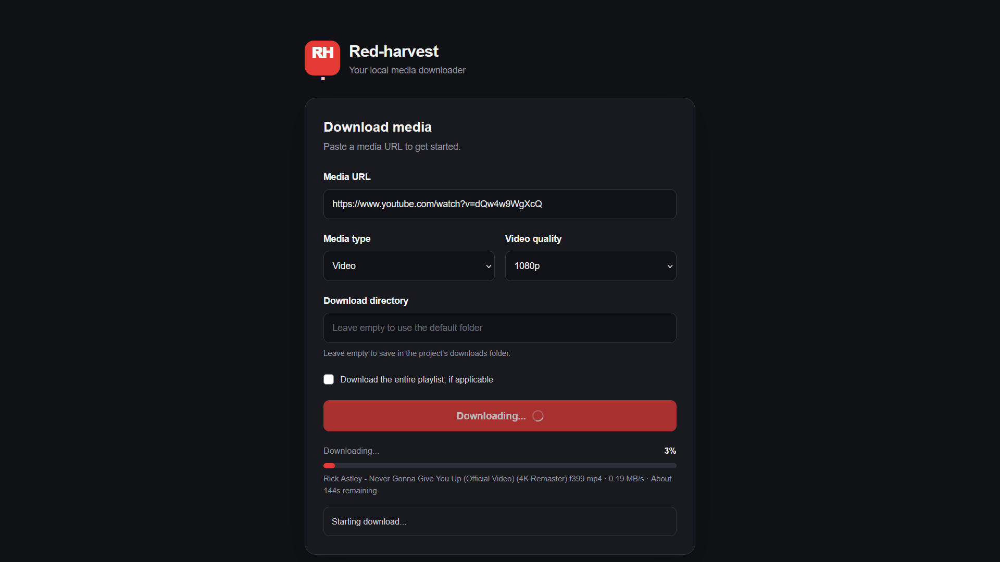

# Red-harvest

Red-harvest is a Python-based media downloader with a local Flask web interface. Powered by yt-dlp and FFmpeg, it supports video and audio downloads, quality selection, playlist downloads, custom output directories, and real-time progress tracking. FFmpeg handles media processing tasks such as audio extraction, MP3 conversion, and merging separate audio and video streams when needed.

## Features

- [x] Download videos
- [x] Download audio as MP3
- [x] Video quality selection
- [x] Playlist support
- [x] Custom download directory
- [x] Local web interface
- [x] Background downloads
- [x] Download progress tracking
- [x] Download status and error reporting
- [ ] Automatic file renaming
- [ ] Automated tests
- [ ] Interactive CLI
- [ ] Desktop GUI
- [ ] Configuration file
- [ ] Batch downloads
- [ ] Download queue and cancellation

## Screenshots

### Main Interface



### Download Progress



> Replace these image paths with your actual screenshots. Create the `docs/images/` directory and add the corresponding PNG files.

## Technologies

- Python
- Flask
- yt-dlp
- FFmpeg
- HTML, CSS, and JavaScript
- pytest (for automated testing)

## Requirements

- Python 3.10 or later
- FFmpeg
- Git
- An internet connection

## Installation

### Windows

1. Clone the repository:

   ```bash
   git clone https://github.com/Omarhagag27/Red-harvest.git
   cd Red-harvest
   ```

2. Create and activate a virtual environment:

   ```bash
   python -m venv .venv
   .venv\Scripts\activate
   ```

3. Install the Python dependencies:

   ```bash
   pip install -r requirements.txt
   ```

4. Install FFmpeg and make sure it is available through your system's `PATH`.

### Linux (Ubuntu/Debian)

1. Install the required system packages:

   ```bash
   sudo apt update
   sudo apt install python3 python3-venv python3-pip git ffmpeg
   ```

2. Clone the repository:

   ```bash
   git clone https://github.com/Omarhagag27/Red-harvest.git
   cd Red-harvest
   ```

3. Create and activate a virtual environment:

   ```bash
   python3 -m venv .venv
   source .venv/bin/activate
   ```

4. Install the Python dependencies:

   ```bash
   pip install -r requirements.txt
   ```

5. Verify that FFmpeg is installed:

   ```bash
   ffmpeg -version
   ```

   If the command displays version information, FFmpeg is available.

### macOS

1. Install Python, Git, and FFmpeg. If you use Homebrew:

   ```bash
   brew install python git ffmpeg
   ```

2. Clone the repository:

   ```bash
   git clone https://github.com/Omarhagag27/Red-harvest.git
   cd Red-harvest
   ```

3. Create and activate a virtual environment:

   ```bash
   python3 -m venv .venv
   source .venv/bin/activate
   ```

4. Install the dependencies:

   ```bash
   pip install -r requirements.txt
   ```

## Usage

1. Activate your virtual environment if it is not already active.
2. Start the application:

   ```bash
   python app.py
   ```

   On Linux or macOS, you can also use `python3 app.py` if needed.

3. Open your browser and navigate to:

   `http://127.0.0.1:5000`

4. Enter a media URL, select the download options, and click **Download**.

Downloaded files are saved to the `downloads/` directory by default. You can specify a different output directory through the interface.

## Running Tests

Automated tests are planned but are not fully implemented yet.

Once the tests are added, install pytest in your activated virtual environment:

```bash
pip install pytest
```

Run the test suite from the project root:

```bash
pytest
```

## Project Structure

```text
Red-harvest/
├── app.py
├── red_harvest/
│   └── downloader.py
├── templates/
│   └── index.html
├── static/
│   ├── style.css
│   └── app.js
├── docs/
│   └── images/
├── downloads/
├── tests/
└── requirements.txt
```

## Roadmap

- [x] Download a single video
- [x] Download audio as MP3
- [x] Video quality selection
- [x] Playlist support
- [x] Custom download directory
- [x] Local web interface
- [x] Background downloads
- [x] Progress tracking
- [ ] Automatic file renaming
- [ ] Automated unit and API tests
- [ ] Integration tests
- [ ] Interactive CLI
- [ ] Desktop GUI
- [ ] Configuration file
- [ ] Batch downloads
- [ ] Download queue and cancellation
- [ ] Cross-platform testing on Windows, Linux, and macOS

## License

This project is licensed under the MIT License.